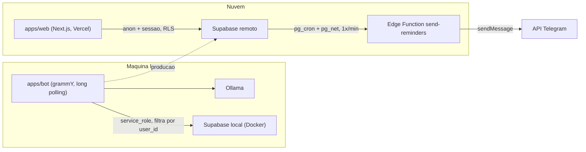
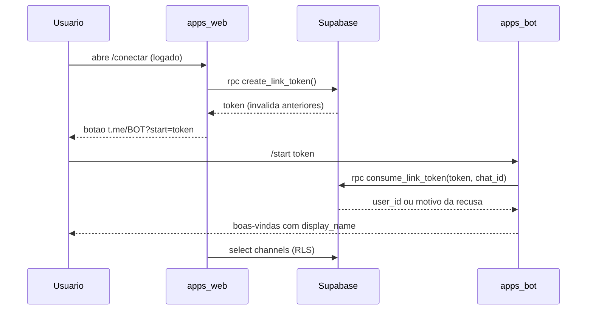
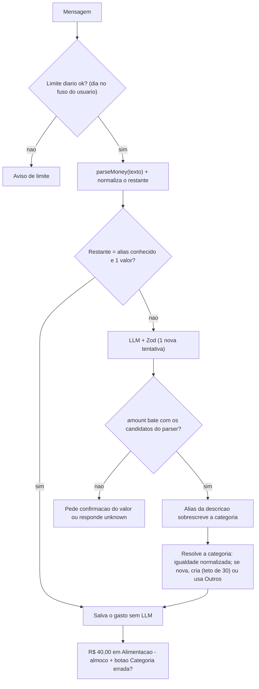

# Alfred — Planejamento revisado das Fases 0 a 3

> Instruções para o agente de código. As regras de trabalho estão em [`CLAUDE.md`](../CLAUDE.md).
> Cada fase é dividida em **incrementos mínimos** (ex: 0.1, 0.2). Faça um incremento por vez: ele deve compilar e ser testável sozinho. Ao final de cada incremento, pare, descreva o que foi feito e como testar, e aguarde aprovação antes de seguir.

---

## 1. Avaliação do plano original

O plano original é bom: os princípios estão certos (IA só para interpretar, lembretes como linhas no banco processadas por job, multiusuário desde o início), as fases estão bem fatiadas e os critérios de aceite são verificáveis. **A estrutura dele foi mantida.** As mudanças abaixo corrigem problemas concretos.

**Divergências com o repositório real** (verificado em 18/10/2026)

- `apps/web` não existe. Será criado na Fase 0.
- A pasta não é um repositório git.
- O `.gitignore` tem `.env.*`, o que também ignora os `.env.example` que o plano exige.
- `apps/bot` usa `typescript ^7.0.2`. É preciso confirmar a compatibilidade com Next.js, Vitest e o gerador de tipos antes de padronizar.
- `supabase/` tem só `config.toml`: não há migrations e o projeto não está vinculado a nenhum remoto.

**Falhas de segurança no desenho original**

- A RLS padrão de "select/update/delete para tudo que tem `user_id`" deixa o usuário editar `channels.external_id`. Ele poderia apontar o próprio canal para o `chat_id` de outra pessoa e mandar lembretes para ela.
- Também deixa o usuário editar `profiles.daily_msg_limit` e assim burlar o limite diário.
- Funções `security definer` (como `claim_due_reminders`) ficam expostas pelo PostgREST para `anon` por padrão. É preciso revogar `execute`.
- Não há garantia de um único canal ativo por usuário, o que faria lembretes serem enviados em duplicidade.
- Faltam duas restrições: o bot deve aceitar só chats privados (um grupo também tem `chat_id`) e os `callback_query` precisam ter a posse do registro verificada.
- `expenses.category_id` pode apontar para a categoria de outro usuário. Isso se resolve com FK composta.

**Confiabilidade e corretude**

- Consumo de token no `/start`: precisa ser atômico, numa única função SQL, para evitar condição de corrida.
- Idempotência: se o bot cair no meio do processamento, o Telegram reentrega o update e o gasto seria duplicado. Será usado um índice único em `(external_chat_id, external_message_id)`.
- Inconsistência no fluxo de aliases: o plano consulta o alias "pela descrição" **antes** do LLM, mas a descrição só existe **depois** do LLM. A solução está na Fase 2.
- `isNewCategory` não deve vir do LLM. É um cálculo determinístico.
- Valores como "1.234,56" são um ponto fraco de modelos pequenos. Um parser determinístico de valores servirá de verificação cruzada.
- Recorrência com `rrule` em JS calcula em UTC. "Toda segunda às 9h" precisa ser calculado no fuso do usuário, com Luxon.
- O LLM erra aritmética de datas. Ele vai devolver data e hora local sem offset, e o código converte.
- O `callback_data` do Telegram tem limite de 64 bytes, e dois UUIDs não cabem.
- O 429 do Telegram (`retry_after`) não estava tratado.
- O segredo do cron não pode ficar escrito em migration. Vai para o Supabase Vault.

---

## 2. Princípios (mantidos)

- IA só para interpretar linguagem natural. Somas, consultas, agendamento e envio são código determinístico.
- Um lembrete nunca depende de um agente "decidir" avisar.
- Multiusuário desde o início, sem vazamento entre usuários.
- Custo de IA zero: Ollama local.
- **Novo:** menor privilégio. As policies de RLS liberam só o que o site usa **hoje**. Escritas sensíveis passam por funções SQL.

---

## 3. Arquitetura



- **Desenvolvimento:** Supabase local (`supabase start`, exige Docker Desktop). Migrations, tipos e testes de RLS rodam localmente. O projeto remoto é usado só para deploy, com `supabase db push`, sempre com confirmação do desenvolvedor.
- O bot roda com long polling, sem porta exposta.
- O Telegram processa os updates de forma **sequencial** (padrão do grammY). Isso é aceitável agora; uma chamada lenta ao LLM atrasa os outros usuários. Paralelizar com `@grammyjs/runner` fica para depois.
- Os lembretes saem pela Edge Function, independentes do processo do bot.

---

## 4. Stack

- **Monorepo:** pnpm workspaces, com Supabase CLI instalada como devDependency na raiz (`pnpm supabase ...`, em vez do `pnpm dlx` lento a cada uso).
- **TypeScript:** `strict: true` em todos os pacotes, com uma única versão na raiz. Antes de padronizar, verificar se TS 7 funciona com Next, Vitest e tsx. Se houver qualquer incompatibilidade, fixar a versão 5.x/6.x mais recente estável.
- **Site:** Next.js (App Router) com `@supabase/ssr`. Usar a convenção da versão instalada (`middleware.ts` ou `proxy.ts`). No servidor, autenticar com `getUser()`/`getClaims()`, nunca confiar só em `getSession()`.
- **Bot:** grammY executado com tsx. O arquivo `.env` é carregado com `tsx --env-file`, o que dispensa o `dotenv`.
- **Validação:** Zod 4 (`z.toJSONSchema`).
- **Datas:** Luxon para fuso e conversões. `rrule` para recorrência.
- **Testes:** Vitest para unidades e pgTAP (`supabase test db`) para RLS e funções SQL.
- **Chaves do Supabase:** aceitar tanto os nomes novos (publishable/secret) quanto os antigos (anon/service_role). Os nomes das variáveis de ambiente continuam os da seção 6.

Ambiente: Windows + PowerShell, um comando por linha, sem `&&`.

---

## 5. Regras e convenções

Todas as regras do plano original continuam valendo: segredos só em `.env`; `service_role` só no bot e nos secrets das Edge Functions; camada `src/db/` com `userId` obrigatório; dinheiro em centavos; `timestamptz` em UTC; uma migration nova para cada mudança; regenerar os tipos; Zod em toda saída do LLM com uma nova tentativa; `bot.catch`; bots de dev e prod separados; uma instância por token; nada destrutivo sem confirmação. **Acréscimos:**

**Segurança**

- O bot só processa `chat.type === 'private'`. Grupos e canais são ignorados e o bot sai deles (`leaveChat`).
- Todo `callback_query` recarrega o registro filtrando por `ctx.userId`. Se não pertencer ao usuário, responde com erro genérico.
- Toda função SQL `security definer` tem `set search_path = ''`, nomes qualificados com schema e `revoke execute ... from public, anon, authenticated`. Depois, `grant` só para quem precisa (`authenticated` ou `service_role`).
- Chats não vinculados: responder com a instrução de conexão e registrar em `message_log` **sem o texto** (minimização de dados, LGPD). A exceção é a Fase 0, quando ainda não existe vínculo.
- O `.env.example` de cada app contém só os nomes das variáveis. No `.gitignore`, `.env.*` vem acompanhado de `!.env.example`.

**Dados**

- `profiles.timezone` é validado contra `Intl.supportedValuesOf('timeZone')` no site.
- "Dia", "mês" e "agora" são calculados sempre no fuso do usuário: limite diário, `/resumo` e prompt do LLM.

**Processo**

- `supabase db reset` só no banco **local**. Nada contra o remoto sem confirmação.
- Commit ao final de cada fase aprovada.

---

## 6. Variáveis de ambiente

`apps/bot/.env` (em dev, apontando para o Supabase local, com valores de `pnpm supabase status`)

```
TELEGRAM_BOT_TOKEN=
TELEGRAM_BOT_USERNAME=
SUPABASE_URL=http://127.0.0.1:54321
SUPABASE_SERVICE_ROLE_KEY=
OLLAMA_BASE_URL=http://localhost:11434
OLLAMA_MODEL=
OLLAMA_TIMEOUT_MS=30000
```

`apps/web/.env.local`

```
NEXT_PUBLIC_SUPABASE_URL=http://127.0.0.1:54321
NEXT_PUBLIC_SUPABASE_ANON_KEY=
NEXT_PUBLIC_TELEGRAM_BOT_USERNAME=
```

**Edge Function (Fase 3):** os secrets `TELEGRAM_BOT_TOKEN` e `CRON_SECRET`. No Vault, `cron_secret` e `send_reminders_url`.

O bot valida tudo em `src/config.ts` com Zod e falha com mensagem clara.

---

## 7. Fase 0 — Fundação

**Objetivo:** uma mensagem enviada ao bot de dev é registrada no Supabase local, e o monorepo compila por inteiro.

**Tarefas**

1. `git init`. Corrigir o `.gitignore` adicionando `!.env.example`, `.next`, `dist`, `supabase/.temp`, `*.log` e `coverage`.
2. Resolver a versão do TypeScript (seção 4) e movê-la para a raiz. Criar `tsconfig.base.json` e estendê-lo em todos os pacotes.
3. Criar `apps/web` com `pnpm create next-app` (TS, App Router, sem `src` opcional), apenas com a página inicial.
4. Criar `packages/db` e `packages/shared` como pacotes internos que exportam o código TS direto (`exports` apontando para `src/index.ts`). No Next, configurar `transpilePackages`.
5. Scripts na raiz: `dev:bot`, `dev:web`, `db:start`, `db:stop`, `db:reset` (só local), `db:types` (`supabase gen types typescript --local`), `typecheck`, `test`.
6. `supabase/config.toml`: `site_url` e `additional_redirect_urls` com `http://localhost:3000`.
7. Migration `init` com `profiles`, `channels`, `link_tokens` e `message_log` (seção 11), RLS e o trigger `handle_new_user`.
8. Bot: `config.ts`, cliente Supabase e a camada `db/`. Um handler grava cada mensagem de texto em `message_log` (com `external_message_id`; uma duplicata é ignorada em silêncio) e responde `Recebi: <texto>`. Implementar o filtro de chat privado, `bot.catch` e o encerramento por `SIGINT`/`SIGTERM` com `bot.stop()`.

**Incrementos**

- **0.1 Repositório:** `git init`, `.gitignore`, `CLAUDE.md`, `package.json` da raiz com `typecheck`, `tsconfig.base.json`, TypeScript na raiz e `apps/bot` estendendo a base com um `src/index.ts` mínimo. Teste: `pnpm typecheck` passa e `git status` não mostra segredos.
- **0.2 Bot "eco":** `config.ts` com Zod, bot grammY com long polling respondendo `Recebi: <texto>`, filtro de chat privado, `bot.catch` e encerramento gracioso. Sem banco ainda. Teste: `pnpm dev:bot` e mandar mensagem ao bot de dev.
- **0.3 Supabase local:** Supabase CLI na raiz, `config.toml`, migration `init` com RLS e trigger, `packages/db` com os tipos gerados. Teste: `pnpm db:start`, `pnpm db:reset`, `pnpm db:types`, `pnpm typecheck`.
- **0.4 Bot grava no banco:** cliente Supabase, camada `db/` e gravação em `message_log` com idempotência. Teste: a mensagem aparece no Studio local, e reprocessar não duplica.
- **0.5 Site e pacote compartilhado:** `apps/web` com create-next-app, `packages/shared`, `transpilePackages`, `dev:web`. Confirmar aqui que o TypeScript 7 funciona com o Next; se não funcionar, fixar a versão estável anterior em todo o monorepo. Teste: `pnpm dev:web` abre a página e `pnpm typecheck` passa nos três pacotes.

As Fases 1 a 3 são divididas em incrementos do mesmo jeito, propostos ao desenvolvedor no início de cada fase.

**Critérios de aceite**

- [ ] `pnpm db:start` sobe o Supabase local e `pnpm db:reset` aplica as migrations do zero.
- [ ] `pnpm dev:bot` sobe sem erros. Uma mensagem recebe resposta e aparece em `message_log`.
- [ ] Reprocessar o mesmo update não duplica a linha.
- [ ] `pnpm db:types` regenera os tipos e `pnpm typecheck` passa nos três pacotes. `pnpm dev:web` abre a página.
- [ ] `git status` não mostra segredos e os `.env.example` aparecem como rastreados.

---

## 8. Fase 1 — Cadastro e conexão da conta

**Objetivo:** o usuário se cadastra, conecta o Telegram com dois cliques e o bot passa a reconhecê-lo.

**Fluxo de conexão**



- **Token:** 32 caracteres `[A-Za-z0-9_-]`, gerados **no banco** por `create_link_token()` (`security definer`, `grant` para `authenticated`). Validade de **30 minutos**. O fluxo leva segundos, e a janela curta reduz o risco se o link vazar. Gerar um token novo invalida os anteriores não usados.
- **`consume_link_token(p_token, p_chat_id)`** (somente `service_role`), numa transação:
  - `update link_tokens set used_at = now() where token = p_token and used_at is null and expires_at > now() returning user_id`;
  - desativa outro canal telegram ativo do mesmo usuário;
  - faz upsert em `channels` por `(type, external_id)`. Se o chat estava vinculado a outro usuário, ele é transferido para o novo dono;
  - devolve o status: `ok`, `invalid`, `expired` ou `used`.

**Tarefas**

1. Auth por magic link com `@supabase/ssr`. Rota `/auth/confirm` no fluxo `token_hash` + `verifyOtp`. Proteção de rotas na convenção do Next instalado. Em dev, os e-mails são lidos no Mailpit/Inbucket local (`http://127.0.0.1:54324`).
2. Páginas: `/`, `/login`, `/conectar` (status + botão), `/configuracoes` (nome e fuso, com o fuso validado).
3. Server Action chamando `create_link_token()`.
4. Bot:
   - `/start` com e sem token, com mensagens distintas para token inválido, expirado e usado;
   - middleware `chat_id → userId` anexado ao contexto (chat não vinculado recebe a instrução e para ali);
   - `/desconectar`;
   - registro dos comandos com `setMyCommands`.
5. `message_log` passa a registrar `user_id`. Chats não vinculados são registrados sem texto.
6. Testes pgTAP em `supabase/tests/` com dois usuários, cobrindo:
   - isolamento de leitura em todas as tabelas;
   - impossibilidade de atualizar `channels`, `link_tokens` e `profiles.daily_msg_limit`;
   - `anon` e `authenticated` sem permissão de executar `consume_link_token`.

**Critérios de aceite**

- [ ] Cadastro e login por magic link funcionam localmente.
- [ ] O fluxo completo de conexão funciona com o bot de dev, e `/conectar` reflete o status.
- [ ] Tokens expirados, usados ou inexistentes são recusados com mensagem clara. Dois `/start` simultâneos com o mesmo token resultam em um único vínculo.
- [ ] Um chat não vinculado e um grupo não conseguem registrar nada.
- [ ] `pnpm supabase test db` passa.

---

## 9. Fase 2 — Registro de gastos com Ollama

**Objetivo:** "gastei 40 reais com almoço" é salvo na categoria certa, reaproveitando as categorias existentes.

**Interface do LLM:** a mesma do plano original (`LLMProvider.extractIntent`), com uma diferença: sai `isNewCategory`, que passa a ser calculado em código.

**Formato de resposta do LLM:** um objeto plano, porque modelos pequenos lidam mal com `anyOf`/`oneOf` no `format` do Ollama. O código converte esse objeto para a união discriminada do domínio:

```ts
const LlmExpenseWire = z.object({
  intent: z.enum(["expense", "unknown"]),
  amount: z.number().nullable(),
  description: z.string().nullable(),
  category: z.string().nullable(),
  occurredAtLocal: z.string().nullable(), // "YYYY-MM-DDTHH:mm" no fuso do usuario, null = agora
});
```

Depois da validação com Zod, o código monta `ExpenseIntent` ou `UnknownIntent` (discriminated union), converte `occurredAtLocal` para UTC com Luxon e recusa datas no futuro.

**Fluxo de uma mensagem**



- **`parseMoney`** é determinístico e coberto por testes. Ele reconhece "40", "40,50", "R$ 1.234,56", "40 reais", "40 conto", "40 pila" e devolve os candidatos em centavos.
- **Normalização** (aplicada a aliases e categorias): minúsculas, sem acento, sem pontuação e sem palavras de preenchimento ("gastei", "paguei", "com", "no", "na", "de", "reais"...).
- **Botões inline:** o `callback_data` usa UUIDs em base64url (22 caracteres), como `ec:<expense>` e `es:<expense>:<category>`, totalizando no máximo 48 bytes. A posse é verificada em cada clique.
- **Correção de categoria:** atualiza o gasto e cria ou atualiza o alias `descrição normalizada → categoria`.
- **Ollama desligado ou lento:** `AbortSignal.timeout(OLLAMA_TIMEOUT_MS)`, aviso ao usuário e erro registrado.
- **Prompt de sistema:**
  - data, hora e dia da semana atuais no fuso do usuário;
  - os próximos 7 dias com o nome do dia da semana, para "segunda que vem" etc.;
  - as categorias do usuário;
  - a instrução de preferir uma categoria existente;
  - exemplos few-shot em português.

**Tarefas**

1. Migration com `categories`, `category_aliases` e `expenses` (seção 11), com RLS e FKs compostas.
2. Categorias padrão (Alimentação, Transporte, Moradia, Saúde, Lazer, Compras, Contas, Outros): função `seed_default_categories(user_id)` chamada pelo trigger, mais backfill dos usuários existentes na mesma migration.
3. `/resumo`: total do mês atual (no fuso do usuário) por categoria. A agregação é feita em SQL com a função `expense_summary(p_user_id, p_from, p_to)`, de uso exclusivo de `service_role`.
4. `apps/bot/tests/fixtures/expenses.json` com 30 ou mais casos (vírgula, "R$", "reais", "conto", milhar, sem valor, dois valores, mensagens que não são gasto, datas como "ontem"). Script `pnpm eval` com a taxa de acerto por campo e a latência média, para escolher o `OLLAMA_MODEL`.
5. Testes Vitest para `parseMoney`, normalização, resolução de categoria, alias, conversão de `occurredAtLocal` e codificação do `callback_data`.

**Critérios de aceite**

- [ ] Mensagens típicas de gasto são registradas corretamente, e valores com milhar e vírgula não erram.
- [ ] "almoço", "restaurante" e "lanche" tendem a cair na mesma categoria existente.
- [ ] Depois de uma correção pelo botão, a mesma mensagem cai na categoria corrigida **sem chamar o LLM** (conferir em `message_log`: `model` nulo).
- [ ] Uma mensagem que não é gasto recebe uma resposta educada.
- [ ] `/resumo` mostra os totais corretos, incluindo gastos perto da meia-noite no fuso do usuário.
- [ ] `pnpm eval` reporta a taxa de acerto.
- [ ] Ollama desligado não derruba o bot.

---

## 10. Fase 3 — Lembretes confiáveis

**Objetivo:** "me lembra amanhã às 9h de pagar a fatura" é entregue no horário certo com o processo do bot parado.

**Recepção (bot)**

- O formato de resposta do LLM ganha `intent: "reminder"`, `text`, `fireAtLocal` (`YYYY-MM-DDTHH:mm`, sem offset) e `rrule` opcional, sem `DTSTART` (ex: `FREQ=WEEKLY;BYDAY=MO`).
- O código converte o horário com Luxon usando `profiles.timezone`, valida que está no futuro e valida a `rrule`. Ao gravar, salva também `timezone` (o fuso do usuário no momento da criação).
- Confirmação ao usuário (ex: "Vou te lembrar seg, 20/10 às 09:00"), com botão de cancelar. `/lembretes` lista os pendentes, cada um com seu botão de cancelar.
- Fixture de avaliação para lembretes ("amanhã", "segunda que vem", "daqui a 2 horas", "todo dia 10").

**Recorrência:** módulo puro `nextOccurrence(rrule, timezone, after)` em `packages/shared`. Ele calcula no horário local do usuário (técnica de "floating time" do `rrule` + Luxon) e devolve UTC, sempre a **próxima ocorrência futura**, sem reenviar ocorrências perdidas. A Edge Function (Deno) importa esse módulo por import map (`rrule` → `npm:rrule`, `luxon` → `npm:luxon`). Se o bundling da CLI não aceitar imports fora de `supabase/functions`, o módulo vai para `supabase/functions/_shared/` e o bot o importa de lá.

**Envio (nuvem)**

1. `claim_due_reminders(batch_size int)`, somente `service_role`, numa transação:
   - devolve para `pending` os lembretes presos em `sending` há mais de 5 minutos;
   - seleciona `pending` com `fire_at <= now()` usando `for update skip locked`;
   - marca como `sending` com `locked_at`;
   - devolve os lembretes junto com o `external_id` do canal ativo;
   - lembretes sem canal ativo vão para `failed` com `last_error = 'no_active_channel'`.
2. A Edge Function `send-reminders` (deploy com `--no-verify-jwt`):
   - compara o header `x-cron-secret` em tempo constante;
   - processa um lote de 25 com cerca de 50 ms entre envios;
   - em caso de sucesso, um lembrete recorrente recebe `nextOccurrence` e volta para `pending`; um lembrete único vai para `sent`;
   - um lembrete único com mais de 10 minutos de atraso é enviado com a marca "(atrasado)";
   - 429: volta para `pending` com `fire_at = now() + retry_after`, sem contar como tentativa;
   - outras falhas: `attempts + 1` e `last_error`; com 5 tentativas, vai para `failed`;
   - 403 (usuário bloqueou o bot): canal → `disconnected` e lembrete → `failed`.
3. Entrega **pelo menos uma vez**. Se o envio funcionar mas a atualização no banco falhar, haverá reenvio após 5 minutos. Isso é aceitável e deve ficar documentado.
4. Agendamento: `pg_cron` + `pg_net` a cada minuto. A URL e o segredo são lidos de `vault.decrypted_secrets`, nunca escritos na migration. Em dev, a URL aponta para `supabase functions serve` acessível a partir do container do banco.
5. Testes: pgTAP para `claim_due_reminders` (concorrência, recuperação de lembretes presos, ausência de canal) e Vitest para `nextOccurrence` (fusos com e sem horário de verão, fim de mês, "todo dia 31").

**Critérios de aceite**

- [ ] Um lembrete é entregue no minuto certo **com o processo do bot parado**, no ambiente local e depois no remoto.
- [ ] Um lembrete recorrente é reagendado corretamente no fuso do usuário.
- [ ] Falhas temporárias são retentadas, e duas execuções simultâneas do cron não duplicam o envio.
- [ ] O bloqueio do bot pelo usuário desativa o canal.
- [ ] Datas relativas respeitam o fuso do usuário.

---

## 11. Schema de referência (com ajustes)

```sql
-- Fase 0 ---------------------------------------------------------------
create table public.profiles (
  id uuid primary key references auth.users(id) on delete cascade,
  display_name text,
  timezone text not null default 'America/Sao_Paulo',
  currency text not null default 'BRL',
  locale text not null default 'pt-BR',
  daily_msg_limit int not null default 100,
  created_at timestamptz not null default now()
);

create table public.channels (
  id uuid primary key default gen_random_uuid(),
  user_id uuid not null references public.profiles(id) on delete cascade,
  type text not null check (type in ('telegram')),
  external_id text not null,
  status text not null default 'active' check (status in ('active', 'disconnected')),
  connected_at timestamptz not null default now(),
  disconnected_at timestamptz,
  unique (type, external_id)
);
create unique index channels_one_active_per_user
  on public.channels (user_id, type) where status = 'active';

create table public.link_tokens (
  token text primary key check (token ~ '^[A-Za-z0-9_-]{32}$'),
  user_id uuid not null references public.profiles(id) on delete cascade,
  expires_at timestamptz not null,
  used_at timestamptz,
  created_at timestamptz not null default now()
);

create table public.message_log (
  id bigint generated always as identity primary key,
  user_id uuid references public.profiles(id) on delete cascade,
  channel_type text not null default 'telegram',
  external_chat_id text not null,
  external_message_id bigint,
  text text,
  intent text,
  model text,
  input_tokens int,
  output_tokens int,
  latency_ms int,
  error text,
  created_at timestamptz not null default now(),
  unique (channel_type, external_chat_id, external_message_id)
);
create index on public.message_log (user_id, created_at);

-- Fase 2 ---------------------------------------------------------------
create table public.categories (
  id uuid primary key default gen_random_uuid(),
  user_id uuid not null references public.profiles(id) on delete cascade,
  name text not null,
  color text,
  created_at timestamptz not null default now(),
  unique (id, user_id)
);
create unique index on public.categories (user_id, lower(name));

create table public.category_aliases (
  user_id uuid not null references public.profiles(id) on delete cascade,
  alias text not null,                 -- normalizado
  category_id uuid not null,
  updated_at timestamptz not null default now(),
  primary key (user_id, alias),
  foreign key (category_id, user_id) references public.categories(id, user_id) on delete cascade
);

create table public.expenses (
  id uuid primary key default gen_random_uuid(),
  user_id uuid not null references public.profiles(id) on delete cascade,
  amount_cents bigint not null check (amount_cents > 0),
  currency text not null default 'BRL',
  description text not null,
  category_id uuid,
  occurred_at timestamptz not null default now(),
  message_log_id bigint references public.message_log(id) on delete set null,
  created_at timestamptz not null default now(),
  foreign key (category_id, user_id)
    references public.categories(id, user_id) on delete set null (category_id)
);
create index on public.expenses (user_id, occurred_at);

-- Fase 3 ---------------------------------------------------------------
create table public.reminders (
  id uuid primary key default gen_random_uuid(),
  user_id uuid not null references public.profiles(id) on delete cascade,
  text text not null,
  fire_at timestamptz not null,
  rrule text,
  timezone text not null,
  status text not null default 'pending'
    check (status in ('pending', 'sending', 'sent', 'failed', 'cancelled')),
  attempts int not null default 0,
  last_error text,
  locked_at timestamptz,
  sent_at timestamptz,
  created_at timestamptz not null default now()
);
create index reminders_due on public.reminders (fire_at) where status = 'pending';
create index on public.reminders (user_id, status);
```

**RLS e permissões (menor privilégio)**

- RLS habilitada em todas as tabelas. Sem policy significa negado.
- `profiles`: `select` próprio. `update` próprio **só** de `display_name`, `timezone` e `locale`, por meio de `revoke update` + `grant update (display_name, timezone, locale)`.
- `channels`: só `select` próprio.
- `link_tokens`: nenhuma policy. Acesso só via `create_link_token()`.
- `message_log`: só `select` próprio.
- `categories`, `category_aliases`, `expenses`: `select` próprio agora. Escritas pelo site entram junto com o dashboard.
- `reminders`: `select` próprio.
- Funções: `create_link_token` → `authenticated`. `consume_link_token`, `claim_due_reminders`, `expense_summary`, `seed_default_categories` → só `service_role`.
- O bot continua filtrando por `user_id` na camada `db/`, mesmo com `service_role`.

---

## 12. Fora do escopo (mantido)

Dashboard, agenda e resumo matinal, consultas em linguagem natural, voz, WhatsApp, convites/admin/cobrança, exportação e exclusão de conta (obrigatória pela LGPD antes de abrir ao público).

Também fica para depois:

- **SMTP próprio** (ex: Resend) para o magic link em produção. O SMTP padrão do Supabase tem limite baixo de envio.
- **Hospedagem do bot fora da máquina local.**
